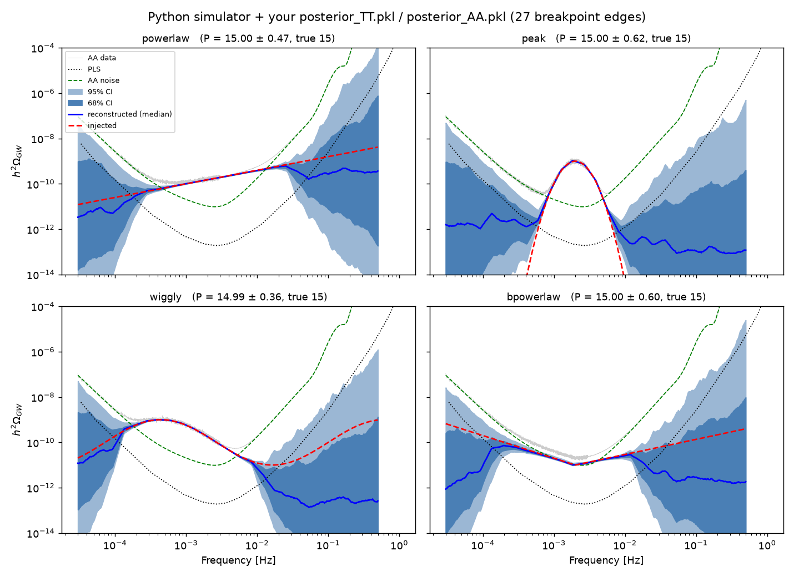

<p align="center">
  
</p>

<p align="center">
  <a href="https://arxiv.org/abs/2309.08430"></a>
  
  
</p>

Simulation-based reconstruction of stochastic gravitational-wave backgrounds with LISA.
A normalising-flow posterior learns a 26-slope piecewise power law for Ω_GW(f) together with the instrument
noise, with no assumption on the spectral shape. Once trained, it reconstructs a new data set in about a second.

<p align="center">
  
</p>
<p align="center"><em>A peaked signal injected in mock LISA data (orange) and its blind reconstruction with
68% / 95% credible bands (blue), using the trained networks in <code>examples/</code>.</em></p>

Paper: *Fast Likelihood-free Reconstruction of Gravitational Wave Backgrounds*,
A. Dimitriou, D. G. Figueroa, B. Zaldívar ([arXiv:2309.08430](https://arxiv.org/abs/2309.08430)).

This is the pure-Python version of the package. Data generation used to live in the Julia package
[GWBackFinder.jl](https://github.com/AndronikiDimitriou/GWBackFinder.jl) and was called through `juliacall`.
Everything now runs in Python/NumPy, with no GPU and no Julia.

## Install

```bash
pip install -e ".[all]"          # numpy, torch, sbi==0.22.0, arviz<1, matplotlib, h5py, pytest
pytest                           # runs the tests
```

`sbi==0.22.0` is the version the shipped `posterior_AA.pkl` / `posterior_TT.pkl` were pickled
with. Load them with `GWBackFinder.posterior.load_posterior`. It also handles the old
`src.GWBackFinder` import path and GPU-trained pickles on CPU-only machines.

## Data model

`GWBackFinder.Simulator` is a line-by-line port of `mock_signal.jl`, `mock_noise.jl` and
`different_signals.jl`. It uses the same frequency grid (`3e-5:1e-6:0.5` Hz), the same binning
(f < 3 mHz unbinned + 1000 log bins → 3970 points), the same noise model and the same
26-slope power law. So the shipped `posterior_AA.pkl` / `posterior_TT.pkl` work on its
output without retraining.

The only change is how the chunk average is drawn. The Julia/CUDA code draws 94 × 4 Gaussians
per frequency. Here we use

    mean over 94 chunks of (e1² + e2²)/2  ~  Gamma(94, 1/94)

so `D = Ω_GW·Γ₁ + Ω_noise·Γ₂` has exactly the same distribution, at about 0.1 s per
simulation on one CPU core. `Simulator(method="gaussian")` keeps the literal chunk-by-chunk version.

```python
from GWBackFinder import Simulator
sim = Simulator()
x_AA = sim.simulate_AA(theta28)                  # (3971,) log10 data + P   (model_train_data)
x_TT = sim.simulate_TT(15.0)                     # (2970,)                  (model_noise_train_data)
X = sim.simulate_AA_batch(thetas, seed=0, n_jobs=-1)   # many at once, in parallel
Data_AA, Data_TT, logf_AA, logf_TT = sim.different_signals("powerlaw", [-10, 0.6], (15, 3))
```

### Breakpoints: 27 edges

The networks in `posterior_AA.pkl` were trained with **27** log-spaced edges between 3e-5 and
0.5 Hz (N_c = 27, as in the paper). The `GWBackFinder.jl` on GitHub has `length=26`. Reconstructing
with 26 edges shifts every spectrum by about 0.08 dex (half a segment) to higher frequency.
`binning` and `Simulator` default to 27; `Simulator(n_edges=26)` gives the GitHub Julia behaviour.

## Results with the trained posteriors

Four test signals simulated with the Python code and reconstructed with `posterior_TT.pkl` → `posterior_AA.pkl`
(`python examples/make_figures.py`):



Simulation-based calibration of the two networks on 2 × 300 simulations. The TT network is calibrated. The AA
network is slightly but reproducibly biased: it overestimates the amplitude and underestimates the noise A, while
its overall coverage stays close to nominal.


## How to run

All commands are run from the repository folder after `pip install -e ".[all]"`.

**0. Check the installation**

```bash
pytest                      # all tests should pass (~10 s)
```

**1. Reconstruct a signal with the trained posteriors (no training needed)**

The trained posteriors are `examples/AA_channel/posterior_AA.pkl` and `examples/TT_channel/posterior_TT.pkl`.

```bash
python examples/Plots.py
```

It does four things:
- simulates a test signal (power law by default; change `signal = ...` to `peak`, `wiggly`, `bpowerlaw`, `dpeak` or `three_peaks`);
- samples the noise parameter P from the TT posterior;
- samples the 26 slopes and amplitude from the AA posterior, given P;
- plots the reconstructed spectrum with its 68%/95% bands against the injected signal, the noise curves and the PLS.

The scripts are split into `#%%` cells, so you can also run them cell by cell in VS Code or Jupyter.

**2. Train new posteriors (optional)**

Train the TT (noise) network first, then the AA (signal) network:

```bash
python examples/TT_channel/generate_data_and_train_TT_channel.py   # -> examples/TT_channel/posterior_noise.pkl
python examples/AA_channel/generate_data_and_train_AA_channel.py   # -> examples/AA_channel/posterior.pkl
```

Set `n_simulations` at the top of each script (100 by default for a quick test, ~1e5 for real
training). Simulations run in parallel on all CPU cores, at ~0.1 s each per core. The simulated
data are also saved to `data_TT.npz` / `data_AA.npz` so they can be reused.

To continue training for more epochs:

```bash
python examples/TT_channel/resume_training_noise.py
python examples/AA_channel/resume_training_signal.py
```

To use newly trained posteriors in step 1, change the two `load_posterior(...)` paths in `examples/Plots.py`.

**3. Generate test data to a file (optional)**

```bash
python examples/choose_template_signals.py -i peak_parameters.h5 -o peak.h5 -s peak
```

`peak_parameters.h5` must contain datasets `parameters_signal` and `parameters_noise` (= `[P, A]`).

## Examples

* `examples/AA_channel`, `examples/TT_channel`: generate data and train / resume training, now without Julia
* `examples/Plots.py`: two-step reconstruction with the shipped posteriors
* `examples/make_figures.py`: regenerates the two figures above in `docs/`
* `examples/calibration.py`: simulation-based calibration (SBC) of the trained AA/TT posteriors
* `examples/choose_template_signals.py`: CLI replacement for `choose_template_signals.jl`

## Julia → Python map

| Julia | Python |
|---|---|
| `binning(f)` | `GWBackFinder.binning(f)` (0-based indices) |
| `f26(S, S0, n0..n25, As, Sb1..Sb25)` | `piecewise_powerlaw(f, slopes, As, breakpoints)` / `f26(...)` |
| `model_train_data`, `model_plot` | `Simulator.simulate_AA(theta, return_freq=...)` |
| `model_noise_train_data`, `model_noise_plot` | `Simulator.simulate_TT(P, return_freq=...)` |
| `different_signals(zPeak(...), zNoise(...), ...)` | `Simulator.different_signals("peak", params, (P, A))` |
| `Omega_noiseh2_AA/TT(f, L, c, P, A)` | same name in `GWBackFinder.noise` |
| `write_sample` (.jld2) | arrays returned directly; save with `np.savez` |
