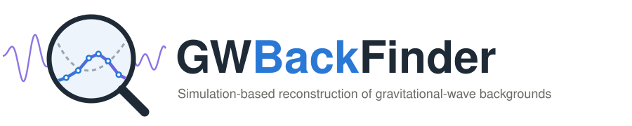
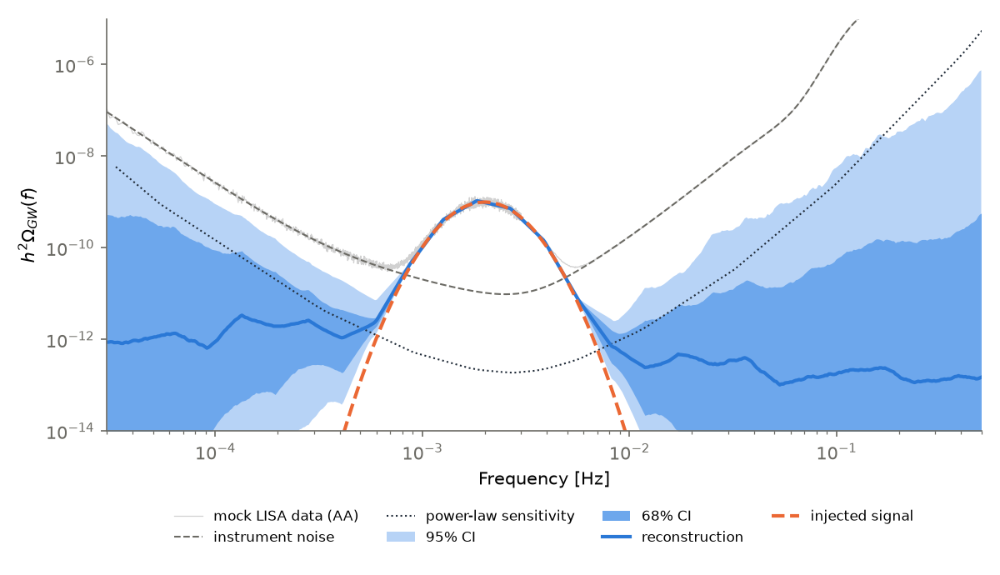
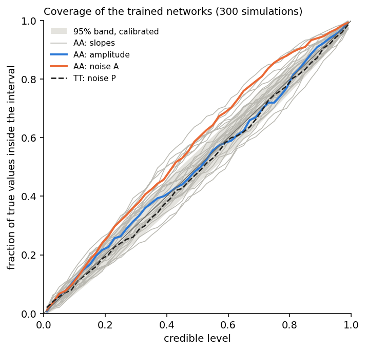

<p align="center">
  
</p>

<p align="center">
  <a href="https://arxiv.org/abs/2309.08430"></a>
  
  
  <a href="https://github.com/AndronikiDimitriou/GWBackFinder/actions/workflows/tests.yml"></a>
  <a href="https://doi.org/10.5281/zenodo.24285804"></a>
</p>

Simulation-based reconstruction of stochastic gravitational-wave backgrounds with LISA.
A normalising-flow posterior learns a 26-slope piecewise power law for Ω_GW(f) together with the instrument
noise, with no assumption on the spectral shape. Once trained, it reconstructs a new data set in about a second.

<p align="center">
  
</p>
<p align="center"><em>A peaked signal injected in mock LISA data (orange) and its blind reconstruction with
68% / 95% credible bands (blue), using the trained networks in <code>examples/</code>.</em></p>

Paper: *Fast Likelihood-free Reconstruction of Gravitational Wave Backgrounds*,
A. Dimitriou, D. G. Figueroa, B. Zaldívar ([arXiv:2309.08430](https://arxiv.org/abs/2309.08430)).

This is the pure-Python version of the package. Data generation used to live in the Julia package
[GWBackFinder.jl](https://github.com/AndronikiDimitriou/GWBackFinder.jl) and was called through `juliacall`.
Everything now runs in Python/NumPy, with no GPU and no Julia.

## Companion package: cosmic strings with astrophysical foregrounds

[**GWBackFinder-foregrounds**](https://github.com/AndronikiDimitriou/GWBackFinder-foregrounds) applies
simulation-based inference to cosmic-string backgrounds in LISA in the presence of the astrophysical
foregrounds (galactic and extragalactic white dwarfs, SOBHBs, EMRIs, MBHBs). Where GWBackFinder reconstructs
the spectral shape model-independently, the companion package infers the string tension Gμ jointly with
the LISA noise and the foreground amplitudes, with MCMC and Fisher cross-checks. It contains the code,
trained posteriors and figures of *Cosmic string gravitational wave backgrounds at LISA: II. Reconstruction
of conventional signals over astrophysical foregrounds* ([arXiv:2607.15219](https://arxiv.org/abs/2607.15219)).

The two packages are installed separately (they use different versions of `sbi`).

## Install

```bash
pip install -e ".[all]"          # numpy, torch, sbi==0.22.0, arviz<1, matplotlib, h5py, pytest
pytest                           # runs the tests (~10 s)
```

With exactly the versions everything was tested with:

```bash
conda env create -f environment.yml && conda activate gwbackfinder
```

`sbi==0.22.0` is the version the shipped `posterior_AA.pkl` / `posterior_TT.pkl` were pickled
with. Load them with `GWBackFinder.posterior.load_posterior`. It also handles the old
`src.GWBackFinder` import path and GPU-trained pickles on CPU-only machines.

## Quick start

```python
from GWBackFinder import Simulator
from GWBackFinder.posterior import load_posterior, sample_two_step

sim = Simulator()
Data_AA, Data_TT, _, _ = sim.different_signals("peak", [-9.0, 0.002, 0.2], (15.0, 3.0), rng=0)
samples, samples_P = sample_two_step(load_posterior("examples/AA_channel/posterior_AA.pkl"),
                                     load_posterior("examples/TT_channel/posterior_TT.pkl"),
                                     Data_AA, Data_TT, n_samples=500)
```

## Tutorials

Notebooks in [`examples/`](examples/), saved with their outputs so they can be read on GitHub
(run them from the `examples/` folder):

| Notebook | What it shows |
|---|---|
| [01 Reconstruction](examples/01_reconstruction.ipynb) | two-step reconstruction (TT → P, AA given P) of the test signals with the trained networks |
| [02 Simulate and train](examples/02_simulate_and_train.ipynb) | simulating training data and training the TT and AA networks |
| [03 Calibration](examples/03_calibration.ipynb) | coverage (simulation-based calibration) of the trained networks |

## Data model

`GWBackFinder.Simulator` is a line-by-line port of `mock_signal.jl`, `mock_noise.jl` and
`different_signals.jl`. It uses the same frequency grid (`3e-5:1e-6:0.5` Hz), the same binning
(f < 3 mHz unbinned + 1000 log bins → 3970 points), the same noise model and the same
26-slope power law. So the shipped `posterior_AA.pkl` / `posterior_TT.pkl` work on its
output without retraining.

The only change is how the chunk average is drawn. The Julia/CUDA code draws 94 × 4 Gaussians
per frequency. Here we use

    mean over 94 chunks of (e1² + e2²)/2  ~  Gamma(94, 1/94)

so `D = Ω_GW·Γ₁ + Ω_noise·Γ₂` has exactly the same distribution, at about 0.1 s per
simulation on one CPU core. `Simulator(method="gaussian")` keeps the literal chunk-by-chunk version.

```python
from GWBackFinder import Simulator
sim = Simulator()
x_AA = sim.simulate_AA(theta28)                  # (3971,) log10 data + P   (model_train_data)
x_TT = sim.simulate_TT(15.0)                     # (2970,)                  (model_noise_train_data)
X = sim.simulate_AA_batch(thetas, seed=0, n_jobs=-1)   # many at once, in parallel
Data_AA, Data_TT, logf_AA, logf_TT = sim.different_signals("powerlaw", [-10, 0.6], (15, 3))
```

### Breakpoints: 27 edges

The networks in `posterior_AA.pkl` were trained with **27** log-spaced edges between 3e-5 and
0.5 Hz (N_c = 27, as in the paper). The `GWBackFinder.jl` on GitHub has `length=26`. Reconstructing
with 26 edges shifts every spectrum by about 0.08 dex (half a segment) to higher frequency.
`binning` and `Simulator` default to 27; `Simulator(n_edges=26)` gives the GitHub Julia behaviour.

## Results with the trained posteriors

Four test signals simulated with the Python code and reconstructed with `posterior_TT.pkl` → `posterior_AA.pkl`
(`python examples/make_figures.py`):


Coverage of the two networks on 300 simulations from the prior: for every credible level, the fraction of
true values inside the posterior interval. A calibrated network follows the diagonal.



## Scripts

The same steps as plain scripts (split into `#%%` cells), run from the repository folder:

| Script | Does |
|---|---|
| `examples/Plots.py` | two-step reconstruction with the shipped posteriors (notebook 01) |
| `examples/TT_channel/generate_data_and_train_TT_channel.py`, `examples/AA_channel/generate_data_and_train_AA_channel.py` | simulate and train (notebook 02); set `n_simulations` (~1e5 for real training) |
| `examples/TT_channel/resume_training_noise.py`, `examples/AA_channel/resume_training_signal.py` | continue training |
| `examples/calibration.py` | per-parameter SBC ranks of the trained networks |
| `examples/make_figures.py` | regenerates the two figures above in `docs/` |
| `examples/choose_template_signals.py -i params.h5 -o out.h5 -s peak` | generate test data to a file (`params.h5`: datasets `parameters_signal`, `parameters_noise` = `[P, A]`) |

## Julia → Python map

| Julia | Python |
|---|---|
| `binning(f)` | `GWBackFinder.binning(f)` (0-based indices) |
| `f26(S, S0, n0..n25, As, Sb1..Sb25)` | `piecewise_powerlaw(f, slopes, As, breakpoints)` / `f26(...)` |
| `model_train_data`, `model_plot` | `Simulator.simulate_AA(theta, return_freq=...)` |
| `model_noise_train_data`, `model_noise_plot` | `Simulator.simulate_TT(P, return_freq=...)` |
| `different_signals(zPeak(...), zNoise(...), ...)` | `Simulator.different_signals("peak", params, (P, A))` |
| `Omega_noiseh2_AA/TT(f, L, c, P, A)` | same name in `GWBackFinder.noise` |
| `write_sample` (.jld2) | arrays returned directly; save with `np.savez` |
